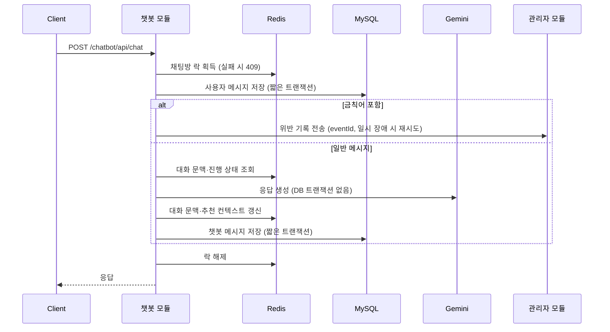

# 📌 요기 U+
> 요금제를 기가막히게 추천해줘 U+

LG U+ 유레카 2기 백엔드 비대면 종합 프로젝트 **최우수상** 수상작의 챗봇 모듈입니다.
팀 프로젝트(2025.06)가 끝난 뒤, 단일 서버를 전제로 작성된 챗봇 모듈을 **다중 인스턴스와 동시 요청 환경에서도 안전하게 동작하도록** 개인적으로 고도화했습니다.

- 관리자(금칙어) 모듈: [admin-backend-enhanced](https://github.com/mike7643/admin-backend-enhanced)

# 🧾 프로젝트 소개
통신 이용 데이터를 기반으로 사용자 유형을 분류하고, 요금제 정보를 통합하여 비교/추천하는 서비스를 구현함으로써, 사용자들에게 통신 상품 선택을 돕는 것을 목표로 합니다.

# 🎯 주요 기능
- ✅ 기능 1: 사용자정보를 기반으로 유플러스 요금제에 대한 정보 제공
- ✅ 기능 2: 정보 제공 시 챗봇형식으로 사용자 친화적으로 제공

# 🔧 고도화

| 문제 | 해결 | 검증 |
| --- | --- | --- |
| 대화 문맥과 시나리오 상태가 서버 메모리에 있어 재시작·스케일 아웃 시 유실 | Redis로 이전 (TTL 24시간) | 재시작 후 문맥 복원 테스트 |
| 싱글턴 서비스 필드에 사용자별 추천 결과를 저장해 동시 요청 시 덮어쓰기 | 요청 단위 상태로 분리, 채팅방 단위 Redisson 락 | 같은 방 직렬화 / 다른 방 병렬 처리 테스트 |
| LLM 응답 대기 중에도 DB 커넥션을 점유해 커넥션 풀 고갈 | 외부 호출 구간을 트랜잭션에서 제외 | 동시 20건: p95 4,342ms → 1,328ms (69.4%↓), 처리량 3.27배 |
| 관리자 모듈 전송 실패 시 재시도하면 위반이 이중 집계될 위험 | 메시지 ID 기반 eventId + 일시 장애만 재시도 | 재시도 정책 테스트, 관리자 모듈 동시성 테스트 |

### 1. 서버 메모리에 묶인 대화 상태 분리 · [#1](https://github.com/mike7643/chatbot-backend-enhanced/pull/1), [#2](https://github.com/mike7643/chatbot-backend-enhanced/pull/2)

- `InMemoryChatMemoryStore` 대신 Redis List 기반 `RedisChatMemoryStore`
  - 채팅 내역 전체는 MySQL에 두고, LLM에 넣는 최근 문맥만 Redis에 저장
  - 삭제 → 재적재 → TTL 설정을 MULTI/EXEC로 묶어, 중간에 실패해도 문맥이 비지 않도록 함
- 채팅방별 진행 상태(첫 메시지 여부, 프롬프트 진행 중 여부)를 Redis Hash로 관리
- 싱글턴 필드에 있던 추천 결과·추출 키워드를 요청 단위 객체로 분리하고, 피드백 재추천에 필요한 추천 컨텍스트는 채팅방별로 Redis에 저장
- `ConcurrentHashMap` 기반 순서 제어를 채팅방 단위 Redisson 락으로 교체
  - 같은 채팅방 메시지만 직렬화하고, 다른 채팅방은 병렬 처리
  - 2초 안에 락을 얻지 못하면 409(`CHAT_ROOM_BUSY`)로 응답
  - 임대 시간을 지정하지 않아 LLM 응답이 길어져도 watchdog이 락을 연장

### 2. LLM 대기 중 DB 커넥션 점유 제거 · [#3](https://github.com/mike7643/chatbot-backend-enhanced/pull/3)

클래스 단위 `@Transactional` 때문에 채팅 응답 전체(메시지 저장 → 감정 분석 → LLM 응답 대기 → 내부 API 호출 → 응답 저장)가 하나의 트랜잭션이었습니다. HikariCP 최대 커넥션이 5개라, 동시 요청이 5개를 넘으면 나머지는 LLM 응답을 기다리는 요청이 커넥션을 반납할 때까지 대기했습니다.

- 채팅 응답 진입점은 `Propagation.NOT_SUPPORTED`, DB 작업은 Repository 단위의 짧은 트랜잭션으로 제한
- LLM 호출이 실패해도 이미 저장된 사용자 메시지는 유지

동시 요청 20건, LLM 지연 1초 고정, 커넥션 풀 5개, 3회 측정 중앙값:

| 지표 | 개선 전 | 개선 후 |
| --- | ---: | ---: |
| p95 | 4,342ms | 1,328ms |
| 처리량 | 4.606 req/s | 15.049 req/s |
| 평균 응답시간 | 2,781ms | 1,320ms |

측정 환경과 한계: [docs/performance/chat-transaction-performance.md](docs/performance/chat-transaction-performance.md)

### 3. 금칙어 기록 전송 신뢰성 · [#4](https://github.com/mike7643/chatbot-backend-enhanced/pull/4)

- 금칙어 사용 기록에 메시지 ID 기반 eventId(`chat-message:{id}`)를 붙여, 관리자 모듈이 같은 메시지를 중복 집계하지 않도록 함
- 관리자 모듈 전송에 3초 타임아웃, 연결 실패·5xx만 최대 2회 지수 백오프 재시도 (4xx는 재시도하지 않음)
- 응답 messageId를 전체 채팅방 기준 최신 메시지(`findTopByOrderByIdDesc`)가 아닌, 현재 요청에서 저장한 메시지로 반환

## 요청 처리 흐름



# 🛠 사용 기술
| 구분 | 기술 |
| --- | --- |
| 언어 | Java 17 |
| 프레임워크 | Spring Boot 3.5.0 |
| ORM | Spring Data JPA (Hibernate) |
| DB | MySQL |
| 캐시·세션·락 | Redis, Redisson |
| LLM | LangChain4j, Gemini (OpenAI 호환 API) |
| 모듈 간 통신 | Spring WebClient |
| 테스트 | JUnit 5, Mockito, H2, Testcontainers (Redis) |

## 테스트 실행

Docker가 실행 중이어야 합니다. 실제 MySQL·LLM이 필요한 E2E 테스트는 기본 빌드에서 제외되며, `CHATBOT_E2E=true`일 때만 실행됩니다.

```bash
./gradlew test
```

# 🧑‍🤝‍🧑 팀 정보
| 이름 | 역할 | 담당 업무 |
|------|------|-------------|
| 서보인 | 팀장 | 인프라 구축, 인증/인가 모듈 |
| 정현경 | 백엔드 개발자 | 사용자, 요금제, 채팅 모듈 |
| 변지민 | 백엔드 개발자 | 사용자, 요금제, 채팅 모듈 |
| 이종규 | 백엔드 개발자 | 추천 시스템 모듈 |
| 김시헌 | 백엔드 개발자 | 챗봇 모듈 |
| 김정민 | 백엔드 개발자 | 챗봇 모듈 |
| 정유민 | 백엔드 개발자 | 관리자 모듈, 챗봇 모듈 고도화 |
